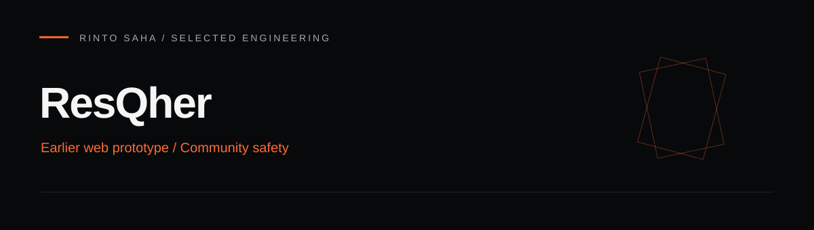

# ResQher



An earlier Laravel web prototype exploring community safety through location sharing, incident history, and coordination between users, volunteers, law enforcement, and administrators. This is a separate codebase from the newer [SheSafe mobile project](https://github.com/saha-rinto-604/SheSafe).

## Source-backed scope

- Authentication and user profile routes.
- User location storage, stopping location sharing, and helper-coordinate queries.
- Volunteer and law-enforcement availability and location workflows.
- Administrative user lists and approval routes.
- Incident-history models and views.

Inspect [routes/web.php](routes/web.php), [controllers](app/Http/Controllers), and [database migrations](database/migrations) for exact behavior. This repository is a prototype and needs security and operational review before deployment. No emergency-service reliability is claimed.

## Stack and structure

PHP, Laravel 12, Blade, MySQL configuration, and Vite for frontend assets. `composer.json` declares PHP `^8.2`; use a runtime compatible with all locked dependencies.

```text
app/Http/Controllers/   User, volunteer, law-enforcement, and admin logic
resources/views/       Blade templates
routes/web.php         Browser routes and middleware
database/migrations/   Application schema
public/assets/         Existing frontend assets
```

## Local setup

Use PHP, Composer, MySQL, and Node.js/npm. Review environment configuration before starting, and use a disposable database with synthetic test users and locations.

```bash
git clone https://github.com/saha-rinto-604/ResQher.git
cd ResQher
composer install
npm ci
```

Create a fresh local `.env` using Laravel's environment conventions and your own database settings. Do not reuse committed environment values or credentials. Set `APP_ENV=local`, disable debug output on any shared deployment, and configure the database connection.

```bash
php artisan key:generate
php artisan migrate
npm run build
php artisan serve
```

Open `http://localhost:8000`. The root redirects to `/login`. Do not run database seeding on valuable data; review seeders first.

## Route guide

| Area | Example route |
| --- | --- |
| Authentication | `/login`, `/register` |
| User workspace | `/user/dashboard`, `/user/profile`, `/user/incident-history` |
| Volunteer workspace | `/volunteer/dashboard` |
| Law-enforcement workspace | `/law-enforcement/dashboard` |
| Administration | `/admin/dashboard` |

## Limitations and next steps

This presentation refresh does not certify runtime behavior. Review authorization, state-changing HTTP routes, operational endpoints, environment handling, and privacy before any external deployment. Add workflow and access-control tests, document delivery constraints, and use synthetic data in demonstrations.

Existing images under `public/assets` include template/demo assets; they should not be presented as screenshots of verified product behavior. Separate interface-design PDFs are available in [ResQher_Figma_Design](https://github.com/saha-rinto-604/ResQher_Figma_Design).

## Attribution

The previous README referred to the upstream `iamsuzon/resqher` project. That attribution is retained here; the clone instructions above point to this repository. Preserve original notices and Git history. The Laravel framework is MIT licensed; verify project-specific licensing and third-party asset licenses before redistribution.
